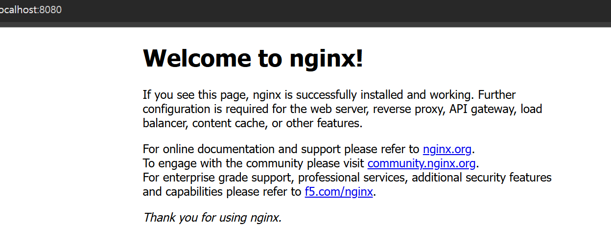
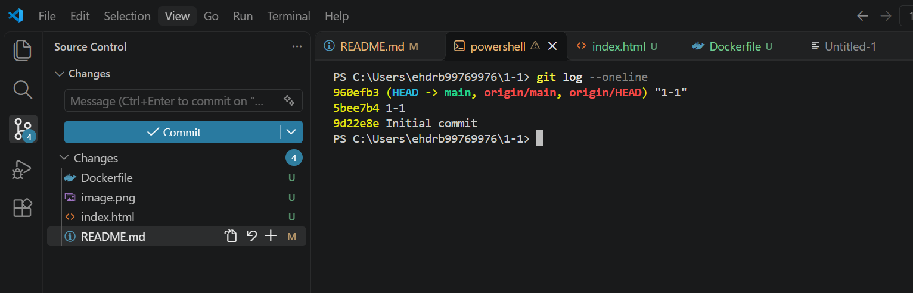

# 2. 터미널 기본 조작 로그

```bash
# 경로 확인
$ pwd
/c/Users/ehdrb99769976/Desktop/1차시
# 파일 만들기
$ touch A

# 폴더 파일 속 파일들 확인
$ ls
A

# 모든 파일의 경로까지 확인
$ ls -a
./  ../  A

# 파일들의 권한을 확인
$ ls -l
total 1
-rw-r--r-- 1 ehdrb99769976 1049089 13 Nov 21 12:41 A

# 모든 하위 파일의 경로, 권한 확인
$ ls -la
total 0
drwxr-xr-x 1 ehdrb99769976 1049089 0 Nov 21 12:39 ./
drwxr-xr-x 1 ehdrb99769976 1049089 0 Nov 21 12:38 ../
-rw-r--r-- 1 ehdrb99769976 1049089 0 Nov 21 12:39 A

# 경로 이동
ehdrb99769976@GNIA-C202-D03 UCRT64 ~/Desktop/1차시
$ cd
ehdrb99769976@GNIA-C202-D03 UCRT64 ~

# 폴더가 아닌 파일로 이동 시도
$ cd A
bash: cd: A: Not a directory

# 존재하지 않는 경로로 이동 시도
$ cd B
bash: cd: B: No such file or directory

# 파일 만들기
$ touch B

# 폴더 만들기
$ mkdir File

# 카피
$ cp A File

# 이동
$ mv B FIle
'''b 파일이 사라지고 c 폴더 안에 b가 생긴것을 확인'''

# 삭제
$ rm A
'''a 파일이 사라짐'''

# 폴더 삭제
$ rm -r File
'''c 폴더가 사라짐'''

# 내용 쓰기
$ echo "hello world!" > A
'''메모장으로 실행하면 hello world!가 적혀있음'''

# 내용 읽기
$ cat A
hello world!
```


# 3. 권한 실습
```bash
# 권한 변경
root@91482fa81423:/File# touch A
root@91482fa81423:/File# ls -l
total 0
-rw-r--r-- 1 root root 0 Nov 21 03:54 A
root@91482fa81423:/File# chmod 777 A
root@91482fa81423:/File# ls -l
total 0
-rwxrwxrwx 1 root root 0 Nov 21 03:54 A
```

# 4. Docker 설치 및 기본 점검
```bash
# 버전 확인
$ dockver --version
Docker version 29.9.3, build 5457199

# 정보 확인
$ docker info
Client:
 Version:    29.9.3
 Context:    desktop-linux
 Debug Mode: false
 Plugins:
  agent: Docker AI Agent Runner (Docker Inc.)
    Version:  v1.153.0
...
```

# 5. Docker 기본 운영 명령
```bash
$ docker images
                                                                                                                i Info →   U  In Use
IMAGE                ID             DISK USAGE   CONTENT SIZE   EXTRA
hello-world:latest   1e4c05b897a7       25.9kB         9.49kB    U
ubuntu:latest        d66b366dac61        163MB         45.9MB    U
$ docker ps
CONTAINER ID   IMAGE           COMMAND       CREATED         STATUS         PORTS     NAMES
f78d2863b2a1   ubuntu:latest   "/bin/bash"   7 minutes ago   Up 7 minutes             YDG

$ docker ps -a
CONTAINER ID   IMAGE           COMMAND       CREATED          STATUS                      PORTS     NAMES
f78d2863b2a1   ubuntu:latest   "/bin/bash"   8 minutes ago    Up 8 minutes                          YDG
d1d26642463e   hello-world     "/hello"      10 minutes ago   Exited (0) 10 minutes ago             admiring_mendeleev
$ docker logs YDG
docker logs YDG
root@f78d2863b2a1:/# ls
bin  boot  dev  etc  home  lib  lib64  media  mnt  opt  proc  root  run  sbin  srv  sys  tmp  usr  var
root@f78d2863b2a1:/# echo "HELLO"
HELLO
$ docker stats YDG
CONTAINER ID   NAME      CPU %     MEM USAGE / LIMIT     MEM %     NET I/O         BLOCK I/O   PIDS
f78d2863b2a1   YDG       0.00%     2.312MiB / 15.25GiB   0.01%     1.17kB / 126B   0B / 0B     1
```

# 6. 컨테이너 실행 연습
```bash

# hello-world
$ docker run hello-world
Unable to find image 'hello-world:latest' locally
latest: Pulling from library/hello-world
4f55086f7dd0: Pull complete
d5e71e642bf5: Download complete
Digest: sha256:1e4c05b897a751332ce85c7e9449da2d93514ea2dea6dbb0e2753c9e949b2bfa
Status: Downloaded newer image for hello-world:latest

Hello from Docker!
This message shows that your installation appears to be working correctly.

To generate this message, Docker took the following steps:
 1. The Docker client contacted the Docker daemon.
 2. The Docker daemon pulled the "hello-world" image from the Docker Hub.
    (amd64)
 3. The Docker daemon created a new container from that image which runs the
    executable that produces the output you are currently reading.
 4. The Docker daemon streamed that output to the Docker client, which sent it
    to your terminal.

To try something more ambitious, you can run an Ubuntu container with:
 $ docker run -it ubuntu bash

Share images, automate workflows, and more with a free Docker ID:
 https://hub.docker.com/

For more examples and ideas, visit:
 https://docs.docker.com/get-started/

#ubuntu컨테이너 실행 및 명령어 실행
$ docker run -dit --name YDG ubuntu:latest
f78d2863b2a1cce6563a86a1b30c1e1d91102dd02cf85e03a1e5d31d78754248

$ docker exec -it YDG bash
root@f78d2863b2a1:/# ls
bin  boot  dev  etc  home  lib  lib64  media  mnt  opt  proc  root  run  sbin  srv  sys  tmp  usr  var
root@f78d2863b2a1:/# echo hello
hello
```

# 7. 기존 DockerFile 기반 커스텀 이미지 제작

(1) 베이스 이미지 선택 및 커스텀 목적
베이스 이미지: nginx:alpine
선택 이유: nginx가 자체 웹 서버 호스팅이 가능함

커스텀 포인트:
COPY: 빌드할때 호스트에 있는 파일 이미지로 붙여넣음
EXPOSE: 기본 웹 포트 명시

(2) 작성된 Dockerfile

```Dockerfile
# nginx 이미지를 베이스로 함
FROM nginx:alpine

# 웹 화면 이미지에 복사 붙여넣기
COPY ./index.html /var/www/html/index.html

EXPOSE 80

# nginx 실행 명령어
CMD ["nginx", "-g", "daemon off;"]
```

(3) 이미지 빌드 및 실행 로그
```bash
docker build -t my-custom-web:1.0 .
[+] Building 4.9s (7/7) FINISHED                            docker:desktop-linux
 => [internal] load build definition from Dockerfile                        0.0s
 => => transferring dockerfile: 151B                                        0.0s
 => [internal] load metadata for docker.io/library/nginx:alpine             2.3s
 => [internal] load .dockerignore                                           0.0s
 => => transferring context: 2B                                             0.0s
 => [internal] load build context                                           0.1s
 => => transferring context: 238B                                           0.0s
 => [1/2] FROM docker.io/library/nginx:alpine@sha256:fb4658584bd9a916ffb6f  1.9s
 => => resolve docker.io/library/nginx:alpine@sha256:fb4658584bd9a916ffb6f  0.0s
 => => sha256:c4f3d97811f679e18a790555496d98de98efbd4a61 20.54MB / 20.54MB  1.5s
 => => sha256:61d8f4c85a745813b78f7b3ea04d0268fd196753e096 1.40kB / 1.40kB  0.5s
 => => sha256:1dc588c89da10830dde2a359d1b421e384caaae52458 1.21kB / 1.21kB  0.6s
 => => sha256:4c8c172c658661b7927fad4ab766c7e6c597d83400a3ed3f 404B / 404B  0.7s
 => => sha256:7cb374baf96870045ef10fb2275d30d893e2010d5fb12d2e 965B / 965B  0.2s
 => => sha256:04c3905a997c5ada93c8e4ad6c8d593e04c5ad4efa87a648 627B / 627B  0.2s
 => => sha256:77a3bfea78f562fc46a238affde2e413f44ebe98eb6a 1.94MB / 1.94MB  0.4s
 => => sha256:881fc932939efef04ca120ad44bbd2c0917851eb247a 3.85MB / 3.85MB  0.5s
 => => extracting sha256:881fc932939efef04ca120ad44bbd2c0917851eb247aa4995  0.1s
 => => extracting sha256:77a3bfea78f562fc46a238affde2e413f44ebe98eb6accd78  0.1s
 => => extracting sha256:04c3905a997c5ada93c8e4ad6c8d593e04c5ad4efa87a648a  0.0s
 => => extracting sha256:7cb374baf96870045ef10fb2275d30d893e2010d5fb12d2e8  0.0s
 => => extracting sha256:4c8c172c658661b7927fad4ab766c7e6c597d83400a3ed3f2  0.0s
 => => extracting sha256:1dc588c89da10830dde2a359d1b421e384caaae52458be045  0.0s
 => => extracting sha256:61d8f4c85a745813b78f7b3ea04d0268fd196753e0964ac6c  0.0s
 => => extracting sha256:c4f3d97811f679e18a790555496d98de98efbd4a61f8741c1  0.2s
 => [2/2] COPY ./index.html /var/www/html/index.html                        0.0s
 => exporting to image                                                      0.5s
 => => exporting layers                                                     0.1s
 => => exporting manifest sha256:01f9103c8adc8b8c3d490c41e38a9cfdbeb4c3b33  0.0s
 => => exporting config sha256:51ac1325dcbffc6268e9227d348b8de8ef6d6f5edd8  0.0s
 => => exporting attestation manifest sha256:47e5da4644721512c61ce4760d28d  0.0s
 => => exporting manifest list sha256:766beaf0c6e36e4556500a3501f801e46572  0.0s
 => => naming to docker.io/library/my-custom-web:1.0                        0.0s
 => => unpacking to docker.io/library/my-custom-web:1.0                     0.4s
 ```

# 빌드된 이미지 확인
```bash
$ docker images
                                                                                                                i Info →   U  In Use
IMAGE                ID             DISK USAGE   CONTENT SIZE   EXTRA
hello-world:latest   1e4c05b897a7       25.9kB         9.49kB    U
my-custom-web:1.0    766beaf0c6e3       93.6MB         26.4MB
ubuntu:latest        d66b366dac61        163MB         45.9MB    U
```

# 8. 포트 매핑 및 접속 증거

```bash
$ docker run -dit --name Username -p 8080:80 my-custom-web:1.0
$ docker ps
CONTAINER ID   IMAGE               COMMAND                   CREATED          STATUS          PORTS                                     NAMES
c421ef817b52   my-custom-web:1.0   "/docker-entrypoint.…"   14 seconds ago   Up 13 seconds   0.0.0.0:8080->80/tcp, [::]:8080->80/tcp   Username
```



# 9. Docker 볼륨 영속성 검증

```bash
$ docker volume create my-volume

$ docker volume ls
DRIVER    VOLUME NAME
local     my-volume

$ docker run -dit -v my-volume:/volumes --name volume ubuntu:latest
3a69ee36c9343037352b2e12658605da16e49d4c1e7dc461cf5b60bc1f7dd7c1

$ docker exec -it volume bash
root@3a69ee36c934:/# ls
bin  boot  dev  etc  home  lib  lib64  media  mnt  opt  proc  root  run  sbin  srv  sys  tmp  usr  var  volumes
root@3a69ee36c934:/# cd volumes
root@3a69ee36c934:/volumes# touch V
root@3a69ee36c934:/volumes# echo "hi" > V
root@3a69ee36c934:/volumes# cat V
hi

$ docker run -dit -v my-volume:/volumes --name volume1 ubuntu:latest
c681d6642fe75c65303bf3591cee1da213671ba42a88f175412df74af0b56502
$ docker exec -it volume1 bash
root@c681d6642fe7:/# cd volumes/
root@c681d6642fe7:/volumes# cat V
hi
```

# 10. Git 설정 및 GitHub 연동

```bash
$ git config --list
diff.astextplain.textconv=astextplain
filter.lfs.clean=git-lfs clean -- %f
filter.lfs.smudge=git-lfs smudge -- %f
filter.lfs.process=git-lfs filter-process
filter.lfs.required=true
http.sslbackend=schannel
core.autocrlf=true
core.fscache=true
core.symlinks=false
pull.rebase=false
credential.helper=manager
credential.https://dev.azure.com.usehttppath=true
init.defaultbranch=master
```



